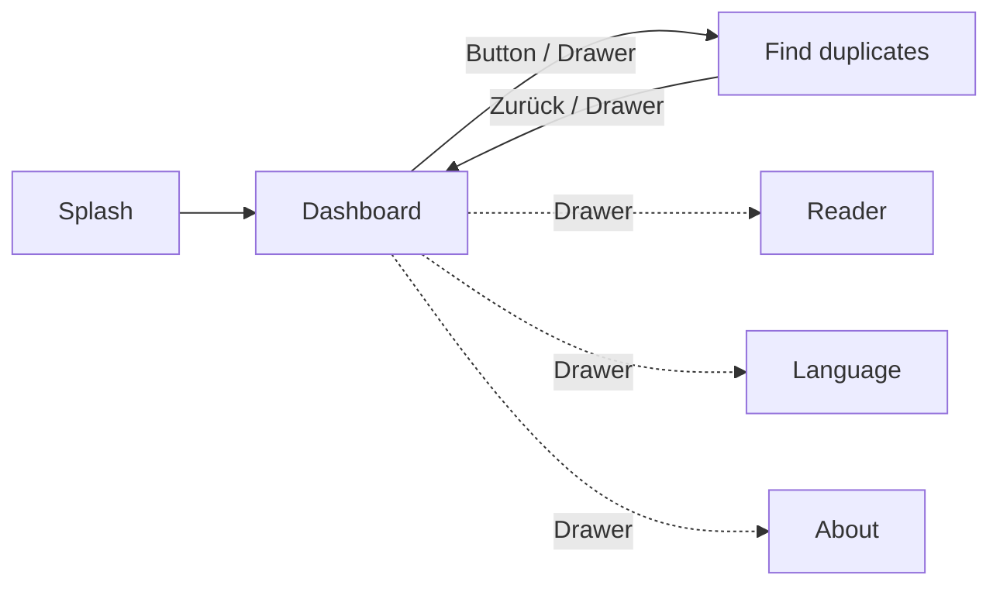
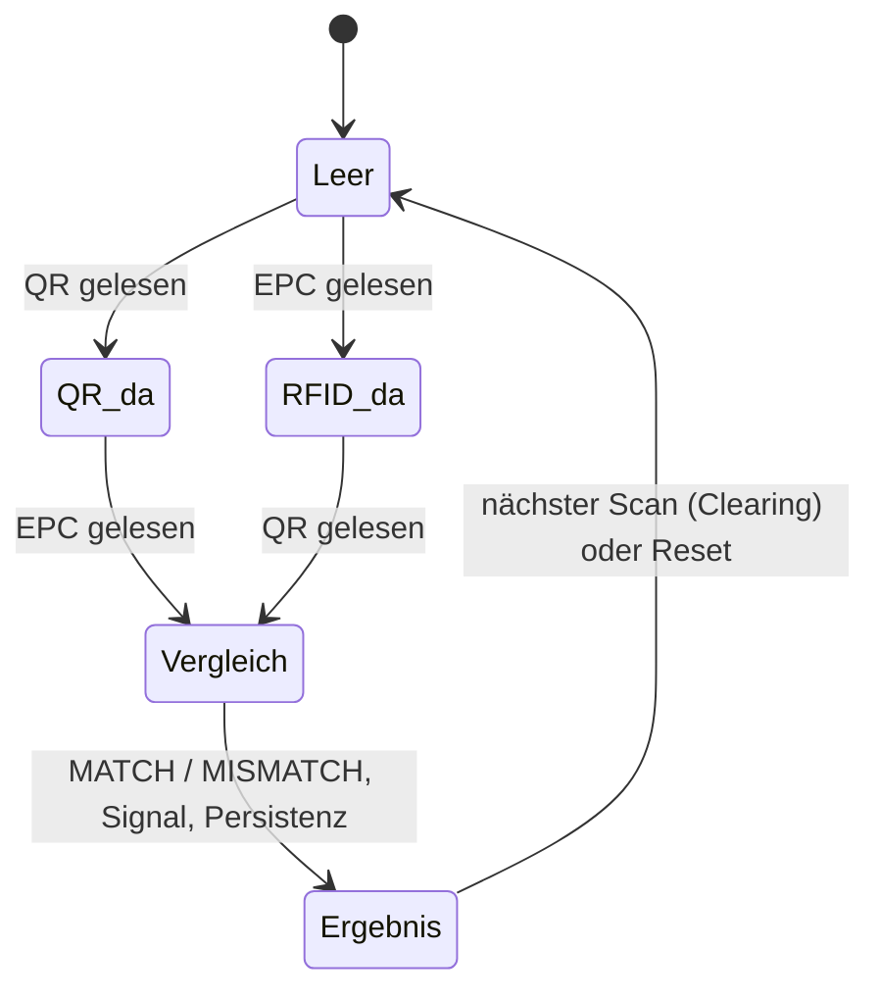
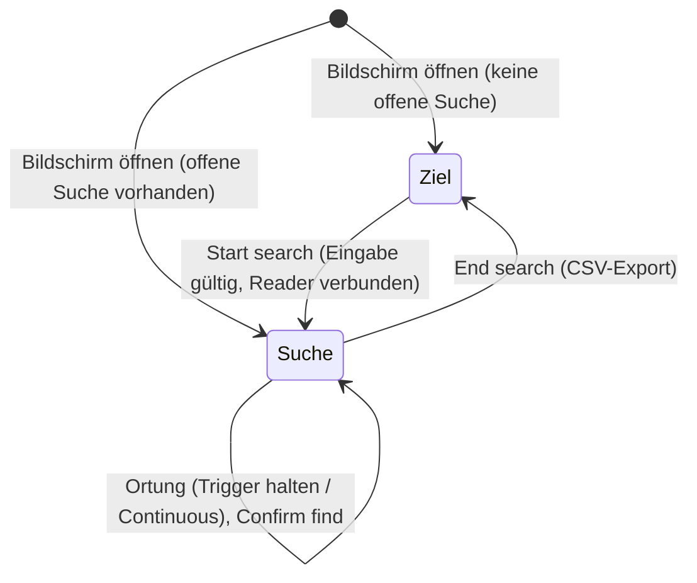

# 02 Produktübersicht und Funktionen

| | |
|---|---|
| **Stand** | 2026-10-01 |
| **Quellen** | Code (`feature/*`, `MainActivity`, `navigation/Nav.kt`), Design-Spec Duplicate Finder |

## 1 Funktionskatalog

| ID | Funktion | Kurzbeschreibung | Status |
|---|---|---|---|
| F-01 | QR/GS1-Scan | Lesen des 2D-Codes über den Honeywell-Scanner (CT37-Taste oder Zebra-Trigger) | umgesetzt |
| F-02 | RFID-Scan (Einzel-Tag) | Lesen genau eines EPC je Trigger-Druck über die RFD8500 | umgesetzt |
| F-03 | Vergleich SGTIN QR ↔ RFID | automatisch, sobald beide Werte vorliegen; Reihenfolge egal | umgesetzt |
| F-04 | Rückmeldung | Ergebnis-Zeile (grün „Match“ / rot „Mismatch“), Ton, Vibration | umgesetzt |
| F-05 | Zyklus-Clearing | Altwerte werden vor dem nächsten abgeschlossenen Zyklus entfernt | umgesetzt |
| F-06 | Tageszähler | „Scans today“, „Mismatches today“ (Live) | umgesetzt |
| F-07 | CSV-Export | Export aller Scans nach `Documents/scans_<Zeitstempel>.csv` | umgesetzt |
| F-08 | Reader-Verwaltung | Auto-Connect beim Start, „Connect“ (Reconnect), Statusanzeige | umgesetzt |
| F-09 | Sendeleistung | interner Pegel 1–30 → Zebra-Leistungsindex; im Reader-Screen **nur Anzeige** („Level 1 of 30“ mit Hinweis, Standard 1 = Minimum); kein Bedienelement (bewusst) | umgesetzt (Anzeige) |
| F-10 | Manuelle GTIN | **entfernt** (hatte keinen UI-Einstieg; Code und Strings 2026-10-01 gelöscht) | entfallen |
| F-11 | Duplikatsuche | Zielvorgabe, Ortung, Confirm find, End search, CSV | umgesetzt |
| F-12 | Sprachauswahl | EN / DE | umgesetzt |
| F-13 | About | App-Name und Version | umgesetzt |

## 2 Bildschirme und Navigation

| Bildschirm | Route | Inhalt | Erreichbar über |
|---|---|---|---|
| Splash | `splash` | App-Name, leitet sofort zum Dashboard | Start |
| **Dashboard** | `dashboard` | Zähler, Ergebniskarte (QR Raw, QR SGTIN, RFID SGTIN, Vergleichsergebnis), Buttons **Reset**, **Export Mismatches (CSV)**, **Find duplicates** | Start, Drawer |
| **Find duplicates** | `duplicates` | Phase 1 „Ziel festlegen“, Phase 2 „Suche“ | Dashboard-Button, Drawer |
| Reader | `reader` | Reader-Status, Button „Connect“, Anzeige der Sendeleistung | Drawer |
| Language | `language` | Auswahl EN / DE | Drawer |
| About | `about` | „QCC“, Version | Drawer |

Das Burger-Menü (`ModalNavigationDrawer`) enthält: Dashboard, Find duplicates, Reader, Language, About. Die Routen `scan` und `export` sind in `Nav.kt` definiert, aber nicht belegt.

## 3 Bedienkonzept

- **Trigger-zentriert:** Der Hauptablauf läuft ausschließlich über die Pistole. Das Dashboard hat bewusst keine Scan-Buttons mehr.
- **Reader-Pflicht:** Ohne verbundenen Reader ist „Start search“ im Duplicate Finder deaktiviert; im Dashboard werden Reader-Fehler als roter Text angezeigt.
- **Rückmeldung:** Erfolg/Ergebnis über Farbe, Ton und Vibration. **Warnungen und Fehler im Duplicate Finder erscheinen als Dialog mit OK**, damit sie nicht übersehen werden; reiner Erfolg („Find #n saved“, Export-Info) als kurze Snackbar.
- **Kein Scrollen in der Suche:** Die Suchmaske des Duplicate Finders passt auf ein Handheld-Display ohne Scrollen (Layouttest 360 × 600 dp).

## 4 Visuelles Design

- Material 3, weiße Karten (`Color.White`) auf hellem Hintergrund, **schwarze** Texte, **schwarze Pill-Buttons mit weißer Schrift**, rot für Fehler/Mismatch (`Color.Red`), grün (`#4CAF50`) für Match.
- Tacho (Proximity-Gauge): Halbkreis, Verlauf rot `#E53935` → gelb `#FBC02D` → grün `#2E7D32`, große Prozentzahl; „atmet“ im Beep-Takt.
- Das App-Theme definiert Hell/Dunkel-Farbschemata (`primary #001F5B`, `secondary #007A53`); die Bildschirme setzen die Farben explizit auf Weiß/Schwarz.
- Hochformat fest (`screenOrientation="portrait"`).

## 5 Zustandsmodell Dashboard (QCC-Zyklus)

Ein neuer Scan nach abgeschlossenem Zyklus löscht zuerst QR, RFID, Ergebnis und Fehler (`startNewCycleIfNeeded`). Ein unvollständiger Zyklus bleibt erhalten.

## 6 Zustandsmodell Duplicate Finder

Details zu Ablauf und Meldungen: [04 Benutzerhandbuch](04-benutzerhandbuch.md), Regeln: [03 Anforderungen](03-anforderungen.md).
