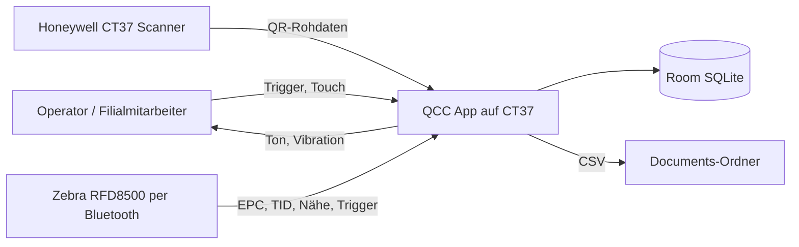

# 03 Anforderungen

| | |
|---|---|
| **Stand** | 2026-10-01 |
| **Quellen** | bisherige Anforderungsdokumente (`docs/03`), Design-Spec Duplicate Finder, Code und Tests |
| **Status-Legende** | ✅ umgesetzt und getestet · 🟡 teilweise / Abweichung · ⛔ nicht umgesetzt · 🧪 nur manuell auf Hardware verifiziert |
| **Priorität** | MoSCoW: Must / Should / Could |

## 1 Systemgrenzen und Akteure



| Akteur | Rolle |
|---|---|
| Operator | führt Scanzyklen aus, bewertet das Ergebnis |
| Filialmitarbeiter | führt die Duplikatsuche durch |
| Zebra RFD8500 | liefert EPC/TID, Trigger-Ereignisse, Nähewerte |
| Honeywell CT37 | Barcode-Scanner, Ton, Vibration, Anzeige |
| Schichtleiter / Qualität | liest Zähler und CSV |

## 2 Funktionale Anforderungen – QCC-Vergleich

### FR-01 QR-Parsing (Must) ✅
- **Trigger:** Barcode-Ereignis. **Eingabe:** Rohstring mit Muster `…/01/<GTIN14>/21/<SERIAL>`.
- **Regeln:** GTIN genau 14 Ziffern; Seriennummer nicht leer; QR-SGTIN wird aus GTIN und Seriennummer gebaut (siehe Seite 07).
- **Fehlerfall:** lesbare Fehlermeldung im UI, Zyklus bleibt offen.
- **Ergebnis:** `QrScanResult(rawValue, gtin, serial, sgtin)`.
- **Trace:** `Gs1ParserService.parseQr`, `ScanViewModel.handleQr` · **Tests:** `Gs1ParserServiceTest*`, `ScanViewModelTest`.

### FR-02 Manuelle GTIN (entfallen) ⛔
Die manuelle Eingabe einer 14-stelligen GTIN (ohne Seriennummer, Vergleich immer `MISMATCH`) hatte im Dashboard keinen UI-Einstieg und wurde am 2026-10-01 **auf Wunsch des Auftraggebers entfernt** (`parseManualQrGtin`, `ScanViewModel.setManualQrGtin`, zugehörige Strings und Tests). Die ID bleibt zur Nachvollziehbarkeit reserviert.

### FR-03 RFID-Parsing (Must) ✅
- Eingabe: Hex-String. Regeln: nur Hex-Zeichen, gerade Länge, genau **24 Zeichen** (SGTIN-96), Header `0x30`, Partition 0–6, GTIN ≠ `00000000000000`, Seriennummer ≠ `0000000000`.
- Ergebnis: `RfidScanResult(epc, sgtin, gtin, readerName, readerBattery, scannedAt)`.
- **Trace:** `Gs1ParserService.parseEpcToSgtin`, `ScanViewModel.handleRfid` · **Tests:** `Gs1ParserServiceTest*`, `Gs1LocateTargetTest`, `ScanViewModelTest`.

### FR-04 Vergleichslogik (Must) ✅
- Vorbedingung: QR- und RFID-Wert liegen vor.
- Vergleich der **normalisierten** SGTINs (`trim` + `lowercase`); QR ohne Seriennummer → `MISMATCH`.
- Nebenwirkung: **jeder** Vergleich → eine Zeile in `scans`; bei `MISMATCH` zusätzlich eine Zeile in `mismatches`.
- **Trace:** `CompareScansUseCase.invoke`, `MismatchRepository.addScan/add`.

### FR-05 Reihenfolgefreiheit (Must) ✅
QR zuerst oder RFID zuerst sind gleichwertig; der Vergleich startet automatisch bei Vollständigkeit (`compareIfReady`). **Tests:** `ScanViewModelTest.rfidFirstThenQr_…`.

### FR-06 Zyklus-Clearing (Should) ✅
Vor einem neuen Wert nach abgeschlossenem Zyklus (QR+RFID vorhanden oder Ergebnis ≠ `IDLE`) werden QR, RFID, Ergebnis und Fehler geleert. Das gilt für Button-Pfad, Hardware-Trigger und CT37-Taste (`startNewCycleIfNeeded` in `handleQr`, `handleRfid`, `triggerQrScan`, `triggerRfidScan`). **Tests:** `ScanViewModelTest.hardwareQrAfterCompletedCycle_…`, `rfidAfterCompletedCycle_…`.

### FR-07 Tagesmetriken (Should) ✅
„Scans today“ und „Mismatches today“ als Live-Zähler. „Heute“ = lokales Kalenderdatum (`date(timestamp/1000,'unixepoch','localtime') = date('now','localtime')`). **Trace:** `MismatchRepository.observeTodayScanCount/observeTodayCount`.

### FR-08 CSV-Export Scans (Should) ✅
- Datei `scans_<yyyyMMdd_HHmmss>.csv` in `Documents`; Spalten `Timestamp,SGTIN,SGTIN Tag,QR Raw,Status` (`Match`/`Mismatch`); **alle** Scans, absteigend nach Zeit.
- **Hinweis:** Der Button heißt „Export Mismatches (CSV)“, exportiert aber die komplette Scan-Historie (Bezeichnung weicht ab, Seite 13).
- **Trace:** `MismatchRepository.exportPendingCsv`, `MediaStoreCsvDocumentWriter`.

### FR-09 Reader-Betrieb (Should) 🟡
- ✅ Auto-Discovery und Verbindung zum ersten gefundenen Reader beim Start (`ScanViewModel.init`); „Connect“ im Reader-Screen für Reconnect; Statustext.
- 🟡 Sendeleistung: Mapping Pegel 1–30 → Leistungsindex vorhanden, Standard 1 (= Index 0, Minimum); **kein Bedienelement** zum Ändern – `ReaderConfigScreen` zeigt den Wert nur an („… dBm“, tatsächlich ein Pegel, keine dBm-Angabe).
- **Trace:** `ZebraRfd8500Gateway.discoverReaders/connect/setPower`.

## 3 Funktionale Anforderungen – Duplikatsuche

### FR-10 Ziel festlegen (Must) ✅🧪
Das Suchziel wird auf drei Wegen vorgegeben:
1. **Anlesen:** Trigger-Druck in Phase 1 liest genau einen Tag im Nahbereich (`CAPTURE`); dessen EPC wird übernommen.
2. **Hex-EPC** (24 Zeichen, muss SGTIN-96 sein).
3. **SGTIN** im Kurzformat `Company.ItemRef.Serial` (z. B. `4065546.092768.12884901894`).

Die Eingabe wird **beim Tippen** ausgewertet; sobald sie gültig ist, erscheinen SGTIN und EPC zur Kontrolle (kein „Apply“-Button). Unvollständige Eingaben erzeugen keine Fehlermeldung. Ungültige Eingabe beim Start → Dialog „Enter a 24-character EPC …“. Kein QR-Scan als Zielquelle (QR- und Tag-Daten können abweichen).
- **Tests:** `DuplicateSearchViewModelTest` (typing…, startSearch_…, capture_…), `Gs1LocateTargetTest`.

### FR-11 SGTIN-Filterwert (Must) ✅
Aus einer SGTIN ist der Filterwert (3 Bit) nicht ableitbar. Standard **1** (Verkaufsartikel), wählbar **0–7** (Chips unter dem Eingabefeld, nur sichtbar bei SGTIN-Eingabe, d. h. wenn die Eingabe einen Punkt enthält). Ein Hex-EPC bringt seinen Filterwert selbst mit. Ein Wechsel kodiert das Ziel neu. Die Partition ergibt sich aus der Stellenzahl des Company Prefix (6–12).

### FR-12 Filiale (Could) ✅
Optionales Freitextfeld „Store“, vorbelegt mit dem zuletzt verwendeten Wert (`SharedPreferences`).

### FR-13 Suche starten (Must) ✅
„Start search“ nur bei nicht-leerer Eingabe, verbundenem Reader und nicht beschäftigtem ViewModel. Der Start wertet die Eingabe selbst aus. Es ist immer nur **eine** Suche offen; eine noch offene Vorgängersuche wird ohne Export geschlossen.

### FR-14 Ortung (Must) ✅🧪
- Trigger **halten** startet die Ortung, **loslassen** stoppt sie.
- Schalter **„Continuous search“** (Standard aus): Ortung läuft ohne Trigger; der Trigger wird dann ignoriert.
- Ortung ist immer **exakt** (volle 96-Bit-Maske), siehe Seite 07 (Hardware-Befund).

### FR-15 Nähe-Feedback (Must) ✅🧪
Relative Nähe 0–100 %: Tacho mit Prozentzahl; Beep über `ToneGenerator` und Vibration im selben Takt; Pause zwischen den Beeps sinkt linear von 1000 ms (1 %) auf 80 ms (100 %); bei 0 % still. Ton und Vibration über das **CT37**, nicht den Beeper der RFD8500. **Tests:** `BeepIntervalTest`.

### FR-16 Confirm find / TID-Prüfung (Must) ✅🧪
Eine laufende Ortung pausiert; das Gateway liest im Nahbereich (5 % Leistung, 700-ms-Fenster) die TIDs (96 Bit) aller Tags mit exakt passendem EPC:

| Ergebnis | Reaktion | Zählt? |
|---|---|---|
| genau 1 Tag, TID in dieser Suche neu und noch nie gefunden | Snackbar „Find #n saved – remove the item“ | ja |
| genau 1 Tag, TID neu in dieser Suche, **aber früher schon gefunden** | **Dialog „Found again“**: „Counted as find #n. This tag was already found on <Datum>. TID: …“ | **ja** |
| genau 1 Tag, TID **bereits in dieser Suche** | **Dialog „Already found“**: „Already counted in this search as find #n (<Datum>). TID: …“ | nein |
| 0 Tags | Dialog „No duplicate at the reader – wrong item?“ | nein |
| mehr als 1 Tag | Dialog „Several duplicates detected – isolate the item“ | nein |

Danach läuft die Ortung weiter, wenn „Continuous search“ aktiv ist – bei offenem Dialog erst nach **OK**.

### FR-17 Eindeutigkeit und Wiederfunde (Must) ✅
Pro Suche zählt eine TID **einmal** (Datenbank-Constraint `UNIQUE(searchId, tid)`). Wird dieselbe TID in einer **späteren** Suche erneut bestätigt (z. B. weil jemand den Tag zurückgelegt hat), **zählt sie erneut** und speichert in `previousFoundAt` den Zeitpunkt des **letzten** früheren Funds; dieser steht im Dialog und in der CSV-Spalte „Previously Found“. **Tests:** `DuplicateSearchRepositoryTest`, `MigrationTest`.

### FR-18 Meldungen (Must) ✅
Alle Warnungen und Fehler (kein Tag, mehrere Tags, Reader nicht verbunden/Fehler, ungültiges Ziel, Anlesen ohne/mit mehreren Tags, Export-Fehler, „Already found“, „Found again“) erscheinen als **Dialog mit OK**, der den Bildschirm blockiert. Während ein Dialog offen ist, werden Hardware-Trigger ignoriert. Reiner Erfolg („Saved“, „Exported“, „Nothing exported“) erscheint als Snackbar und verschiebt das Layout nicht. **Tests:** `DuplicateSearchViewModelTest.onlyPlainSuccessMessages_…`, `pendingAcknowledgement_…`, `continuousMode_waitsForDismissBeforeLocatingAgain`.

### FR-19 End search und Export (Must) ✅
Ortung stoppen, Suche als beendet markieren, **CSV automatisch exportieren** (`duplicates_<yyyyMMdd_HHmmss>_<searchId>.csv`, Spalten `Timestamp,SGTIN,EPC,TID,Find No,Store,Previously Found`, Köpfe immer englisch), Dateiname anzeigen, zurück zu Phase 1. Ohne Funde keine Datei („No duplicates found – nothing exported“). Der Abschluss ist idempotent; schlägt der Export fehl, bleibt die Suche offen und kann wiederholt werden.

### FR-20 Suche fortsetzen (Should) ✅
Existiert beim Öffnen eine Suche ohne Ende, startet der Bildschirm direkt in Phase 2 mit Ziel, Filiale, Zähler und **zuletzt gelesener TID** (aus der DB wiederhergestellt).

### FR-21 Isolation von QCC (Must) ✅
Der Duplicate Finder darf den QCC-Vergleich **nie blockieren oder beeinflussen**:
- Der Trigger-Modus hat einen **Besitzer**; nur der zuletzt belegende Bildschirm kann ihn an `QCC` zurückgeben, ein spät abgebauter alter Bildschirm kann keinen neuen zurücksetzen.
- Beim Verlassen/Hintergrund: Ortung stoppt, Modus zurück auf `QCC`; Locate-Starts nach dem Verlassen werden verworfen.
- Solange der Duplicate Finder offen ist, ignoriert `ScanViewModel` QR-/RFID-/Trigger-Ereignisse (keine Töne, keine Vergleiche, keine Einträge in `scans`).
- **Tests:** `staleViewModelStopping_…`, `screenStoppedTwice_…`, `continuousRequestedAfterScreenStopped_…`, `ScanViewModelTest.scansWhileSuspended_…`. 🧪 Rückmeldung des Anwenders nach Installation auf dem CT37 am 2026-10-01: „passt“ (Einzelpunkte der Prüfliste wurden nicht protokolliert).

### FR-22 Einstieg (Must) ✅
Button **„Find duplicates“** im Dashboard (unter „Export Mismatches (CSV)“) und Eintrag im Burger-Menü; es wird nie ein zweiter Duplicates-Eintrag gestapelt (`launchSingleTop`).

## 4 Nicht-funktionale Anforderungen

| ID | Anforderung | Nachweis | Status |
|---|---|---|---|
| NFR-01 | Läuft auf Android ab API 28; Ziel/Compile 34 | Build-Konfiguration; Installation auf CT37 (Android 14) | ✅ (API 28–33 nicht getestet; CSV-Export auf API 28 benötigt `WRITE_EXTERNAL_STORAGE`, nicht deklariert) |
| NFR-02 | Architektur MVVM, Hilt, Room, Navigation Compose | Strukturreview, Seite 05 | ✅ |
| NFR-03 | Rückmeldung (Ton/Vibration) unmittelbar nach Scan | manueller Test auf Hardware | 🧪 |
| NFR-04 | Parse-/Verbindungsfehler als benutzerlesbare Meldung | Negativtests Parser/ViewModel | ✅ (QCC-Meldungen teils deutsch hart codiert) |
| NFR-05 | UI-Texte in `values`, `values-de`, `values-pl` | Resource-Review | 🟡 (QCC-ViewModel/UseCase-Meldungen und Reader-Status deutsch hart codiert; in DE/PL fehlen `match`, `mismatch`, `ok`) |
| NFR-06 | Robuste lokale Persistenz inkl. verlustfreier Migration (Schema 8) | `MigrationTest` (6→7, 7→8), Repository-Tests | ✅ |
| NFR-07 | Suchmaske des Duplicate Finders ohne Scrollen auf Handheld-Display | `DuplicateSearchScreenLayoutTest` (360×600 dp, Gauge ≥ 80 dp); Anwender-Abnahme CT37 | ✅🧪 |
| NFR-08 | Offline-Betrieb (kein Netzwerkzugriff) | Manifest ohne `INTERNET` | ✅ |
| NFR-09 | Nahbereichs-Lesen: nur Tags direkt an der Pistole | Hardware-Spike: 5 % Leistung liest bei Kontakt, ca. 30 cm nichts | 🧪 |
| NFR-10 | Hardware-Zugriff nie im UI-Layer, nur über Gateways | Strukturreview | ✅ |
| NFR-11 | Keine Blockade zwischen Use Cases (siehe FR-21) | Tests, Hardware | ✅🧪 |

## 5 Business Rules

| ID | Regel |
|---|---|
| BR-01 | Vergleich nur, wenn QR **und** RFID vorliegen. |
| BR-02 | QR ohne Seriennummer ist nicht matchbar → `MISMATCH` (nur noch als Absicherung; `parseQr` verlangt eine Seriennummer). |
| BR-03 | EPC muss SGTIN-96-konform sein. |
| BR-04 | Ein neuer abgeschlossener Zyklus startet mit bereinigten Vorwerten. |
| BR-05 | Jeder Vergleich erzeugt genau einen `scans`-Datensatz (Mismatch zusätzlich einen `mismatches`-Datensatz). |
| BR-06 | Pro Bestätigung wird genau **ein** Tag akzeptiert; bei mehreren Treffern muss der Artikel isoliert werden. |
| BR-07 | Die **TID** identifiziert einen physischen Tag; je Suche zählt sie einmal. |
| BR-08 | Eine in früherer Suche gefundene TID zählt in einer späteren Suche erneut und trägt den Zeitpunkt des letzten Vorfunds. |
| BR-09 | Gefundene Artikel werden physisch entfernt; die App stummschaltet keine Tags. |
| BR-10 | Ortung und TID-Prüfung suchen immer exakt (volle EPC-Maske). |
| BR-11 | Es ist höchstens eine Duplikatsuche gleichzeitig offen. |
| BR-12 | Der Duplicate Finder gibt Trigger und Reader beim Verlassen an den QCC-Modus zurück. |

## 6 Randbedingungen

- Zielhardware CT37 + RFD8500; vendor-SDKs als lokale AARs (`app/libs/`, `vendor/zebra/`), nicht über Maven.
- SQLite auf API < 35 kennt kein `DROP COLUMN` → Recreate-Table-Muster bei Schemaänderungen.
- Das Zebra-Gateway arbeitet im QCC-Modus bewusst im **Einzel-Tag-Modus** (genau ein EPC je Inventory-Session).
- RFD8500 akzeptiert Locate-Masken nur, wenn sie ab dem MSB lückenlos 1 sind.

## 7 Use Cases

### UC-01 Artikelidentität prüfen (QCC)

| | |
|---|---|
| Akteur | Operator (primär); Zebra-Reader, Honeywell-Scanner (sekundär) |
| Vorbedingung | App geöffnet, Dashboard sichtbar, Reader verbunden |
| Normalfluss | 1) Operator hält Artikel an die Pistole und drückt den Trigger. 2) System startet QR- und RFID-Lesung. 3) System parst beide Werte, aktualisiert die Anzeige. 4) Sobald beide da sind, Vergleich. 5) Ergebnis mit Farbe, Ton, Vibration. 6) Persistenz in `scans` (+ `mismatches`). |
| Alternativen | A1 Umgekehrte Reihenfolge. A2 Neuer Zyklus nach abgeschlossenem Vergleich löscht Vorwerte. |
| Ausnahmen | E1 Ungültiger QR → Fehlermeldung, Zyklus bleibt offen. E2 Ungültiger EPC → Fehlermeldung. E3 Reader getrennt → Statusmeldung, Reconnect über Reader-Screen. |

### UC-02 Duplikate eines EPC finden

| | |
|---|---|
| Akteur | Filialmitarbeiter |
| Vorbedingung | Reader verbunden; Zielwert bekannt oder ein Duplikat zum Anlesen verfügbar |
| Normalfluss | 1) „Find duplicates“ öffnen. 2) Ziel per Anlesen, EPC oder SGTIN vorgeben (+ optional Filiale). 3) „Start search“. 4) Trigger halten, mit dem Reader über die Ware streichen: Tacho, Beep, Vibration führen zum Artikel. 5) Artikel entnehmen, direkt an die Pistole halten, „Confirm find“. 6) Meldung beachten, Artikel entfernen. 7) Schritte 4–6 wiederholen. 8) „End search“ → CSV. |
| Alternativen | A1 „Continuous search“ ohne Trigger. A2 Suche verlassen und später fortsetzen (offene Suche bleibt gespeichert). |
| Ausnahmen | E1 0 oder mehrere Tags → Dialog, Artikel isolieren/prüfen. E2 TID schon gezählt → Dialog „Already found“. E3 Tag aus früherer Suche → zählt, Dialog „Found again“ mit Datum. E4 Reader getrennt → Ortung stoppt, Dialog; Funde sind bereits gespeichert. |

## 8 Akzeptanzkriterien (Gherkin)

```gherkin
AC-01 Reihenfolgefreiheit
  Given das Dashboard ist aktiv
  When zuerst RFID und danach QR gelesen wird
  Then wird ein Vergleichsergebnis angezeigt

AC-02 Zyklus-Clearing
  Given ein abgeschlossener Zyklus mit sichtbaren Werten
  When der nächste Scan beginnt
  Then werden QR, RFID und Ergebnis vor dem neuen Zyklus entfernt

AC-03 Persistenz Match
  Given ein Vergleich mit Ergebnis MATCH
  Then entsteht genau ein Datensatz in scans und keiner in mismatches

AC-04 Persistenz Mismatch
  Given ein Vergleich mit Ergebnis MISMATCH
  Then entsteht genau ein Datensatz in scans und genau einer in mismatches

AC-05 Fehlerbehandlung QR
  Given ein ungültiger QR-Inhalt
  When der Parser läuft
  Then wird eine lesbare Fehlermeldung im UI gesetzt

AC-06 Ziel ohne Apply
  Given Phase 1 des Duplicate Finders
  When ich eine gültige SGTIN tippe
  Then erscheinen SGTIN und EPC ohne weiteren Button

AC-07 Wiederfund
  Given eine TID wurde in einer früheren Suche gefunden
  When ich sie in einer neuen Suche bestätige
  Then zählt der Fund, und ein Dialog nennt das Datum des Vorfunds

AC-08 Doppelter Tipp
  Given eine TID wurde in dieser Suche bereits gezählt
  When ich sie erneut bestätige
  Then zählt sie nicht erneut, und ein Dialog "Already found" mit TID erscheint

AC-09 Isolation
  Given ich war im Duplicate Finder und wechsle zum Dashboard
  When ich den Pistolen-Trigger drücke
  Then läuft der QCC-Scan wie zuvor, und es läuft keine Ortung weiter

AC-10 Eine Bildschirmseite
  Given die Suchphase auf einem 360x600dp-Display
  Then sind alle Karten und beide Buttons ohne Scrollen sichtbar
```

## 9 Traceability-Matrix

| Geschäftsziel | Anforderung | Akzeptanz | Test / Nachweis | Code |
|---|---|---|---|---|
| O1 schnelle Prüfung | FR-01, FR-03, FR-04, FR-05 | AC-01 | `ScanViewModelTest`, Parser-Tests | `ScanViewModel`, `Gs1ParserService`, `CompareScansUseCase` |
| O1 Bedienklarheit | FR-06 | AC-02 | `ScanViewModelTest` | `startNewCycleIfNeeded` |
| O2/O3 Nachvollziehbarkeit | FR-07, FR-08, BR-05 | AC-03, AC-04 | `ScanViewModelTest` (Persistenz), manuell (CSV) | `MismatchRepository` |
| O2 Prozessstabilität | NFR-04, NFR-06 | AC-05 | Negativtests, `MigrationTest` | Parser, Room |
| O4 Duplikate finden | FR-10…FR-16, FR-19 | AC-06 | `DuplicateSearchViewModelTest`, `Gs1LocateTargetTest`, Hardware | `DuplicateSearch*`, `ZebraRfd8500Gateway` |
| O4 Wiederfunde belegen | FR-17, BR-07, BR-08 | AC-07, AC-08 | `DuplicateSearchRepositoryTest`, `MigrationTest` | `DuplicateSearchRepository`, `MIGRATION_7_8` |
| Robustheit | FR-21, NFR-11 | AC-09 | `DuplicateSearchViewModelTest`, `ScanViewModelTest`, Hardware | `TriggerModeArbiter`, `ScanViewModel.setSuspended` |
| Bedienbarkeit am Handheld | FR-18, NFR-07 | AC-10 | `DuplicateSearchScreenLayoutTest`, Anwender-Abnahme | `DuplicateSearchScreen` |

## 10 Abweichungen Ist ↔ frühere Dokumentation

| Frühere Aussage (docs/01–05, SETUP, AGENTS) | Ist |
|---|---|
| DB-Schema v6, zwei Tabellen | Schema **8**, vier Tabellen |
| Dashboard mit Buttons „QR Scan“, „RFID Scan“ | entfernt; Scan nur per Trigger; neu: „Find duplicates“ |
| FR-09 „Sendeleistung kann angepasst werden“ | nur Anzeige, kein Bedienelement |
| Drawer: Scan, Export, Reader, Language, About | Dashboard, Find duplicates, Reader, Language, About |
| Manuelle GTIN-Eingabe (FR-02) | entfernt (2026-10-01) |
| QCC-Ziel „kein Scan ohne Hardware“ | unverändert; zusätzlich Isolation zwischen Use Cases (FR-21) |
