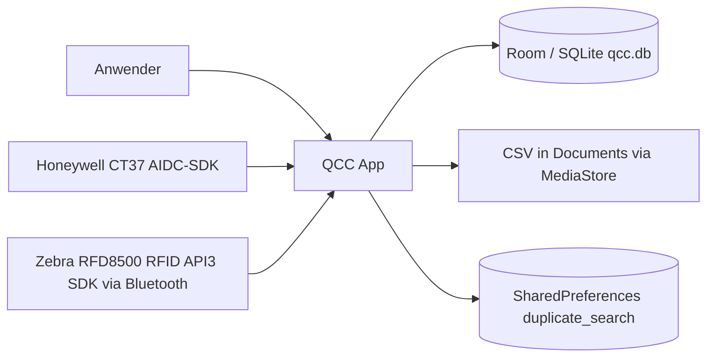
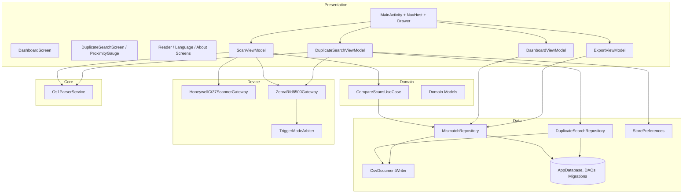
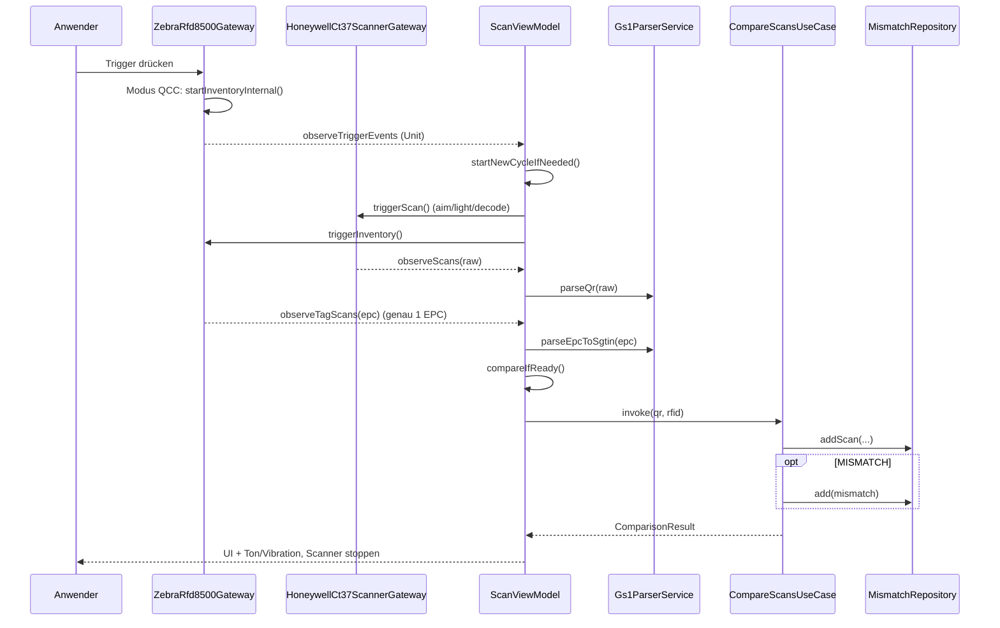
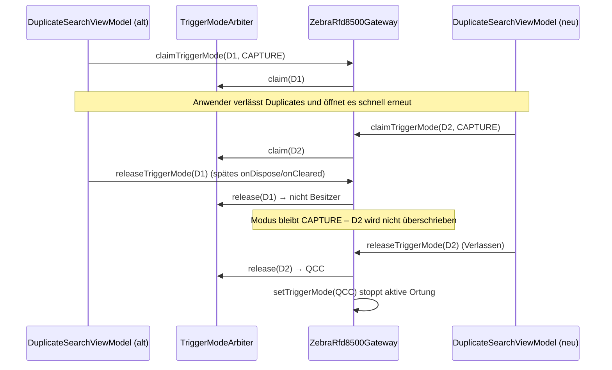
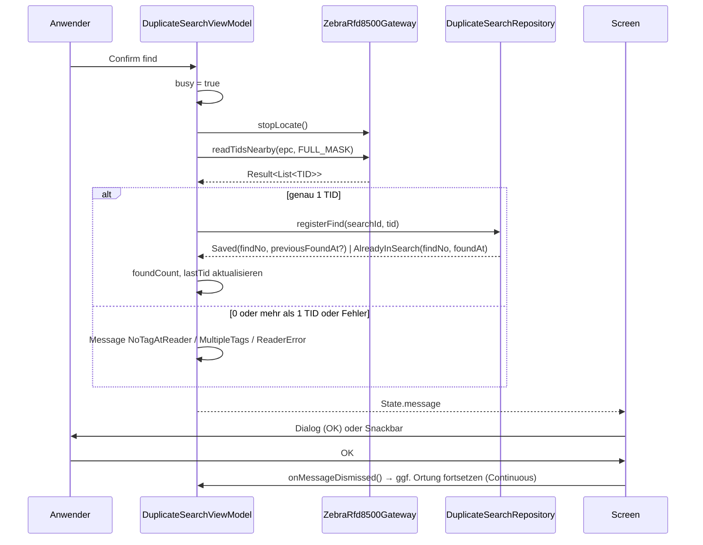

# 05 Architektur

| | |
|---|---|
| **Stand** | 2026-10-01 |
| **Quellen** | Code unter `app/src/main/java/de/ca/qcc/`, `CLAUDE.md`, `AGENTS.md`, Design-Spec Duplicate Finder |
| **Verwandte Seiten** | [06 Datenmodell](06-datenmodell.md), [07 Schnittstellen und Hardware](07-schnittstellen-und-hardware.md), [12 Architekturentscheidungen](12-architekturentscheidungen.md) |

## 1 Architekturziele und Leitprinzipien

| Ziel | Umsetzung |
|---|---|
| G1 verlässlicher Echtzeit-Vergleich am Shopfloor | Gateways liefern Ereignisse als `Flow`; ein ViewModel orchestriert Zyklus und Vergleich |
| G2 klare Verantwortlichkeiten | Schichten UI / Domain / Data / Device / Core |
| G3 Wartbarkeit trotz Vendor-SDKs | Hardwarezugriff nur über Gateway-Interfaces (`BarcodeScannerGateway`, `RfidReaderGateway`) |
| G4 Erweiterbarkeit um weitere Use Cases | Feature-Pakete; ein Use Case darf die anderen nicht beeinflussen (Trigger-Besitz, QCC-Pause) |
| G5 Nachvollziehbarkeit | Room-Persistenz + CSV |

Prinzipien: MVVM mit unidirektionalem Datenfluss (State runter, Events hoch), reaktive Ströme (`StateFlow`/`SharedFlow`), pure-Kotlin-Fachlogik ohne Android-Abhängigkeit (`Gs1ParserService`), typisierte Ergebnisse statt UI-Texte im Duplicate Finder, Schemaänderungen nur mit Migration.

## 2 Kontext (C4 Ebene 1)



Externe Systeme zur Laufzeit gibt es nicht (kein Netzwerk). Geplante Erweiterung: EPCIS-2.0-Endpunkt (Seite 13).

## 3 Schichten (C4 Ebene 2/3)



### Paketstruktur

```text
de.ca.qcc
├── app/            MainActivity (Compose-Wurzel, Navigation, Drawer, Lifecycle-Hooks), App (@HiltAndroidApp)
├── navigation/     Screen (sealed class mit Routen)
├── feature/
│   ├── dashboard/  DashboardScreen, DashboardViewModel
│   ├── scan/       ScanViewModel (Zyklus, Vergleichsauslösung, Feedback)
│   ├── export/     ExportViewModel
│   ├── duplicates/ DuplicateSearchScreen, DuplicateSearchViewModel, ProximityGauge, ProximityFeedback
│   ├── reader/     ReaderConfigScreen
│   ├── language/   LanguageScreen
│   └── about/      AboutScreen
├── domain/
│   ├── model/      Models.kt (@Serializable-Datenklassen, LocateTarget, RegisterFindResult)
│   └── usecase/    CompareScansUseCase
├── data/
│   ├── local/      AppDatabase, Entities, Daos, Migrations, StorePreferences
│   ├── repository/ MismatchRepository, DuplicateSearchRepository
│   └── export/     CsvDocumentWriter (+ MediaStore-Implementierung, csvEscape)
├── device/
│   ├── honeywell/  BarcodeScannerGateway, HoneywellCt37ScannerGateway
│   └── zebra/      RfidReaderGateway, TriggerMode, TriggerModeArbiter, ZebraRfd8500Gateway
├── core/gs1/       Gs1ParserService
├── di/             AppModule, GatewayModule
└── ui/theme/       QccTheme
```

## 4 Bausteine und Verantwortung

| Baustein | Verantwortung |
|---|---|
| `MainActivity` | Compose-Wurzel, `NavHost`, Drawer; erzeugt die **NavHost-weiten** ViewModels (`ScanViewModel`, `DashboardViewModel`, `ExportViewModel`); Honeywell-Lifecycle (`onResume` → `claim`, `onPause` → `release`, `onDestroy` → `close`); Bluetooth-Berechtigungsanfrage; pausiert `ScanViewModel` auf der Duplicates-Route; Keyboard-Modus nur im Duplicate Finder `ADJUST_RESIZE` |
| `ScanViewModel` | QCC-Zyklus: empfängt QR/EPC/Trigger, `startNewCycleIfNeeded`, `compareIfReady`, Ton/Vibration, Reader-Auto-Connect, Fehlertexte; **ignoriert Ereignisse, solange `suspended`** |
| `CompareScansUseCase` | Vergleich (Normalisierung, Match-Regel) und Persistenz (`scans`, ggf. `mismatches`) |
| `Gs1ParserService` | QR, manuelle GTIN, SGTIN-96-EPC → SGTIN/GTIN; SGTIN-Kurzformat → EPC-Hex; `parseLocateTarget`, `encodeSgtin96` |
| `MismatchRepository` | Room-Zugriff für `scans`/`mismatches`, Tageszähler, Scan-CSV-Export |
| `DuplicateSearchRepository` | Suchen/Funde (transaktional), offene Suche laden, `finishSearch` (idempotent, CSV vor Abschluss), `registerFind`-Regeln |
| `DuplicateSearchViewModel` | Zustand beider Phasen, Live-Auswertung der Eingabe, Confirm-Logik, Meldungen (`DuplicateMessage`), Trigger-Besitz, Locate-Serialisierung per `Mutex`; **destination-scoped** |
| `ProximityFeedback` (`ToneProximityFeedback`) | Beep-Schleife (`ToneGenerator`) und Vibration abhängig von der Nähe; Besitzer ruft `release()` |
| `ZebraRfd8500Gateway` | Discovery, Connect, Konfiguration, Einzel-Tag-Inventory (QCC), Trigger-Modi, Ortung, Nahbereichs-Lesen (EPC/TID), Leistung |
| `HoneywellCt37ScannerGateway` | AIDC-Scanner im Client-Control-Modus; Trigger → decode; Ergebnis → `SharedFlow` |
| `TriggerModeArbiter` | Besitzer-Logik für den Trigger-Modus |
| `AppModule`/`GatewayModule` | Hilt-Bindings (DB `qcc.db` mit Migrationen 1→8, Repositories, Gateways als `@Singleton`, `CsvDocumentWriter`, `ProximityFeedback`) |

## 5 Laufzeitsichten

### 5.1 QCC-Vergleichszyklus



### 5.2 Trigger-Routing nach Modus

Der Pistolen-Trigger wird **im Gateway** nach `TriggerMode` verteilt:

| Modus | Trigger gedrückt | Trigger losgelassen | Konsument |
|---|---|---|---|
| `QCC` (Standard) | Single-Tag-Inventory starten, `observeTriggerEvents()` | Inventory stoppen, falls noch kein Tag gelesen | `ScanViewModel` |
| `CAPTURE` (Duplicates, Phase 1) | `observeHandheldTrigger(true)` → Anlesen | `observeHandheldTrigger(false)` | `DuplicateSearchViewModel` |
| `LOCATE` (Duplicates, Phase 2) | `observeHandheldTrigger(true)` → Ortung starten | `…(false)` → Ortung stoppen (nicht bei Continuous) | `DuplicateSearchViewModel` |

`eventReadNotify` verzweigt zusätzlich nach laufender Operation: **Nearby-Lesen** (`nearbySink`) vor **Ortung** (`locateActive`, Nähewerte → `proximityFlow`) vor **QCC-Single-Tag** (`inventoryActive`, `compareAndSet` für Genau-einmal-Zustellung).

### 5.3 Besitz des Trigger-Modus (Isolation zwischen Use Cases)



Zusätzlich: Das Duplicates-Composable meldet `onScreenStarted()` (ON_START) bzw. `onScreenStopped()` (ON_STOP/Dispose, idempotent); `startLocating()` prüft `screenActive`. `MainActivity` setzt `ScanViewModel.setSuspended(true)` solange `currentRoute == duplicates`.

### 5.4 „Confirm find“



### 5.5 Navigation und ViewModel-Scopes

| ViewModel | Scope | Begründung |
|---|---|---|
| `ScanViewModel`, `DashboardViewModel`, `ExportViewModel` | **Activity-/NavHost-Ebene** (`hiltViewModel()` in `AppNav`) | historisch gewachsen; leben so lange wie die Activity |
| `DuplicateSearchViewModel` | **Destination** (`hiltViewModel()` im `composable("duplicates")`) | Muster für künftige Use-Case-Screens; wird beim Verlassen (Pop) geräumt |

Navigation: `Splash → Dashboard`; „Find duplicates“ mit `launchSingleTop` und `popUpTo(Dashboard)`; Drawer-Eintrag „Dashboard“ räumt den Back-Stack (`popUpTo(Dashboard){inclusive}`).

## 6 Nebenläufigkeit und Threading

- Hardware-Ereignisse kommen auf **SDK-Threads** und werden mit `MutableSharedFlow.tryEmit()` (nicht blockierend, `DROP_OLDEST`) weitergereicht.
- Gateway-Operationen laufen auf `Dispatchers.IO`; ViewModels auf `Dispatchers.Main` (`viewModelScope`).
- Locate-Start/-Stop sind per `Mutex` serialisiert; `stopLocating` läuft in `NonCancellable`, damit ein abgebrochener Scope Reader und Ton trotzdem stoppt.
- Gemeinsame Gateway-Zustände sind `@Volatile` bzw. `AtomicBoolean` (`inventoryActive`, `locateActive`, `nearbyActive`).
- `ToneProximityFeedback` besitzt einen eigenen Scope (`Dispatchers.Default`); der `ToneGenerator` gehört der Beep-Schleife.

## 7 Querschnittsthemen

| Thema | Umsetzung |
|---|---|
| Lokalisierung | String-Ressourcen EN/DE/PL; Duplicate-ViewModel liefert typisierte `DuplicateMessage`, die UI lokalisiert (`stringResource`). QCC-ViewModel/UseCase und Reader-Status enthalten noch deutsche Klartexte (Schuld) |
| Fehlerbehandlung | `Result`/`runCatching` an Gateway-Grenzen; Reader-Fehler werden lesbar gemacht (`readableFailure`); Parser wirft `IllegalArgumentException` mit Text |
| Logging | Android `Log`, Tag `QccZebra` (Moduswechsel, fehlgeschlagene Inventory-/Locate-Operationen); kein Crash-Reporting |
| Theming | `QccTheme` (Material 3); Bildschirme setzen Weiß/Schwarz explizit |
| Dependency Injection | Hilt; Gateways `@Singleton`; `ProximityFeedback` und `CsvDocumentWriter` nicht singleton-gebunden |
| Persistenz | Room mit exportiertem Schema (`app/schemas/`), Migrationen 1→8 |
| Berechtigungen | Bluetooth (Laufzeit), Vibration; weitere im Manifest siehe Seite 11 |

## 8 Qualitätsszenarien

| Attribut | Szenario | Maßnahme / Nachweis |
|---|---|---|
| Verfügbarkeit | Reader trennt sich während der Ortung | `DISCONNECTION_EVENT` setzt Flags zurück; ViewModel stoppt Ortung, meldet „Reader not connected“; Funde bereits gespeichert |
| Robustheit | Schneller Wechsel Dashboard ↔ Duplicates | Trigger-Besitz, idempotentes `onScreenStopped`, `screenActive`-Guard (Tests) |
| Datenintegrität | Gleichzeitige Registrierung derselben TID | Transaktion + `UNIQUE(searchId, tid)` + `OnConflictStrategy.IGNORE` |
| Wiederholbarkeit | Export schlägt fehl | CSV wird **vor** dem Schließen der Suche geschrieben; Wiederholung möglich |
| Bedienbarkeit | kleines Display | feste Spalte, flexibler Gauge, Layouttest 360×600 dp |
| Wartbarkeit | neuer Use Case | Feature-Paket, destination-scoped ViewModel, Trigger-Besitz-API |

## 9 Technische Schulden (Architektur)

| ID | Schuld | Wirkung |
|---|---|---|
| AR-01 | QCC-ViewModel/UseCase/Gateway-Status mit deutschen Klartexten | nicht lokalisiert |
| AR-02 | `ScanViewModel`/`DashboardViewModel`/`ExportViewModel` Activity-weit gescoped | Seiteneffekte bei Feature-Wachstum; erklärt die Notwendigkeit von `setSuspended` |
| AR-03 | Vendor-AARs lokal im Repository | Reproduzierbarkeit/Größe; R8-Problem (Seite 10) |
| AR-04 | Keine instrumentierten Tests; Gateways (SDK) ungetestet | Hardware-Pfade nur manuell |
| AR-05 | Routen teils als Strings (`"reader"` …) und Platzhalter-Routen `scan`/`export` | uneinheitlich |
| AR-06 | App-Titel „QCC“ als Literal in `DashboardScreen` (statt `R.string.app_name`) | blockiert die Umbenennung zu „MV-C“ |
