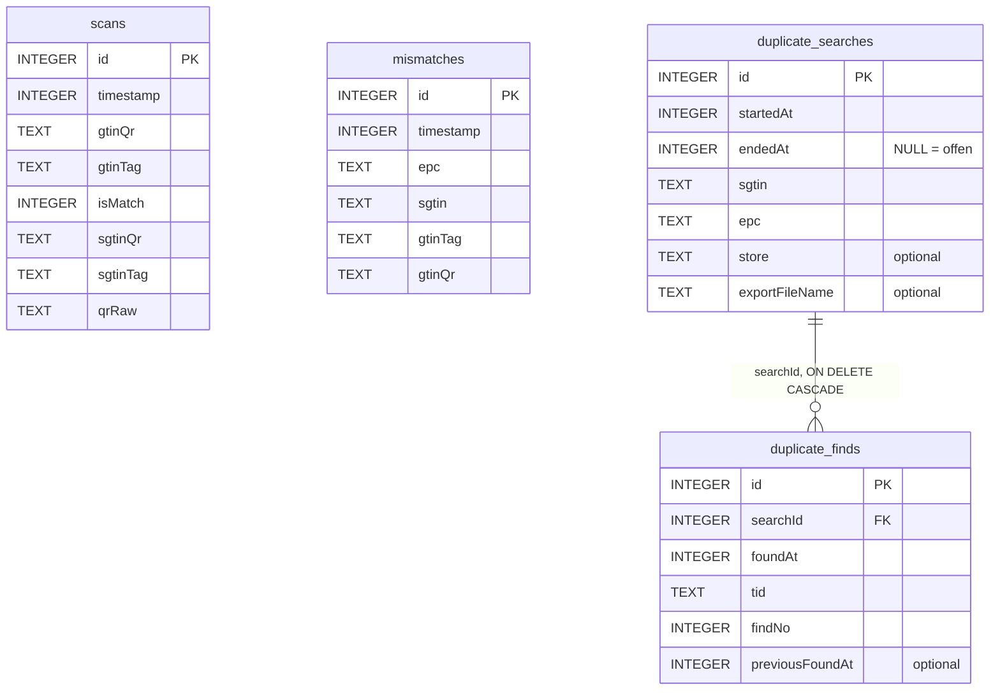

# 06 Datenmodell

| | |
|---|---|
| **Stand** | 2026-10-01 |
| **Quellen** | `data/local/Entities.kt`, `Daos.kt`, `Migrations.kt`, `AppDatabase.kt`, `domain/model/Models.kt`, exportierte Schemata `app/schemas/de.ca.qcc.data.local.AppDatabase/{6,7,8}.json` |

## 1 Überblick

Persistenz: **Room** (SQLite), Datei `qcc.db` im privaten App-Speicher, **Schema-Version 8**, Schemaexport aktiv. Daneben `SharedPreferences` (`duplicate_search`) und zwei CSV-Exportformate.



`scans` und `mismatches` sind **unabhängig** voneinander (keine Fremdschlüssel).

## 2 Tabellen

### 2.1 `scans` – jeder QCC-Vergleich

| Spalte | Typ | Null | Bedeutung |
|---|---|---|---|
| `id` | INTEGER PK autoGenerate | nein | |
| `timestamp` | INTEGER | nein | Epoch-Millisekunden |
| `gtinQr` | TEXT | nein | GTIN-14 aus dem QR |
| `gtinTag` | TEXT | nein | aus dem EPC abgeleitete GTIN-14 |
| `isMatch` | INTEGER (Boolean) | nein | Ergebnis |
| `sgtinQr` | TEXT, Default `''` | nein | normalisierter QR-SGTIN (lowercase) |
| `sgtinTag` | TEXT, Default `''` | nein | normalisierter RFID-SGTIN |
| `qrRaw` | TEXT, Default `''` | nein | QR-Rohstring |

Nutzung: Tageszähler, CSV-Export. Einfügen mit `REPLACE`.

### 2.2 `mismatches` – nur Abweichungen

| Spalte | Typ | Bedeutung |
|---|---|---|
| `id` | INTEGER PK autoGenerate | |
| `timestamp` | INTEGER | Epoch-ms |
| `epc` | TEXT | gelesener EPC (Hex) |
| `sgtin` | TEXT | RFID-SGTIN (Pure Identity) |
| `gtinTag` | TEXT | GTIN aus Tag |
| `gtinQr` | TEXT | GTIN aus QR |

Nutzung: Zähler „Mismatches today“, Liste der letzten Mismatches (`observeLatest`).

### 2.3 `duplicate_searches` – eine Suche

| Spalte | Typ | Null | Bedeutung |
|---|---|---|---|
| `id` | INTEGER PK autoGenerate | nein | |
| `startedAt` | INTEGER | nein | Start (Epoch-ms) |
| `endedAt` | INTEGER | ja | Ende; **`NULL` = laufende Suche** |
| `sgtin` | TEXT | nein | Kurzformat `gcp.itemRef.serial` |
| `epc` | TEXT | nein | 24 Hex-Zeichen **inkl. verwendetem Filterwert**; gesucht wird exakt |
| `store` | TEXT | ja | Filiale |
| `exportFileName` | TEXT | ja | Name der exportierten CSV (nach Abschluss) |

Regel: höchstens **eine** offene Suche (`startSearch` schließt eine offene Vorgängersuche ohne Export; Abfrage `getOpenSearch` sortiert nach `startedAt DESC, id DESC`).

### 2.4 `duplicate_finds` – ein Fund

| Spalte | Typ | Null | Bedeutung |
|---|---|---|---|
| `id` | INTEGER PK autoGenerate | nein | |
| `searchId` | INTEGER FK → `duplicate_searches.id` | nein | `ON DELETE CASCADE` |
| `foundAt` | INTEGER | nein | Zeitpunkt (Epoch-ms) |
| `tid` | TEXT | nein | **TID in Großbuchstaben** (96 Bit = 24 Hex) |
| `findNo` | INTEGER | nein | fortlaufende Nummer **je Suche** (1, 2, …) |
| `previousFoundAt` | INTEGER | ja | Zeitpunkt des **letzten** Funds derselben TID in einer **anderen** Suche; `NULL` = erstmals gefunden |

**Indizes:** `UNIQUE(searchId, tid)` (je Suche eine TID), `INDEX(tid)` (Suche über alle Suchen).

### 2.5 Wichtige Abfragen

| Zweck | Abfrage (sinngemäß) |
|---|---|
| Tageszähler | `COUNT(*) … WHERE date(timestamp/1000,'unixepoch','localtime') = date('now','localtime')` (je Tabelle) |
| Offene Suche | `SELECT * FROM duplicate_searches WHERE endedAt IS NULL ORDER BY startedAt DESC, id DESC LIMIT 1` |
| Fund in dieser Suche | `… WHERE searchId = :s AND tid = :t LIMIT 1` |
| Vorfund | `SELECT MAX(foundAt) FROM duplicate_finds WHERE tid = :t AND searchId != :s` |
| Letzte TID | `SELECT tid … WHERE searchId = :s ORDER BY findNo DESC LIMIT 1` |

## 3 Domänenmodelle (Kotlin, `domain/model/Models.kt`)

| Klasse | Felder | Zweck |
|---|---|---|
| `QrScanResult` | `rawValue`, `gtin`, `serial?`, `sgtin?` | geparster QR (`serial` ist nach Wegfall der manuellen GTIN immer gesetzt; Typ blieb nullable) |
| `RfidScanResult` | `epc`, `sgtin`, `gtin`, `scannedAt`, `readerName?`, `readerBattery?` | geparster SGTIN-96-EPC |
| `ComparisonStatus` | `IDLE`, `MATCH`, `MISMATCH`, `ERROR` | Zyklusstatus (`ERROR` wird derzeit nicht vergeben) |
| `ComparisonResult` | `status`, `gtinQr?`, `gtinTag?`, `message`, `comparedAt` | Vergleichsergebnis |
| `MismatchRecord` | `id`, `timestamp`, `epc`, `sgtin`, `gtinTag`, `gtinQr` | Mismatch (Domain-Sicht) |
| `ReaderStatus` | `isConnected`, `readerName?`, `batteryPercent?`, `message` | Reader-Zustand (Batterie derzeit nie befüllt) |
| `LocateTarget` | `epc`, `sgtin`; Konstanten `FULL_MASK` (24×`F`), `DEFAULT_SGTIN_FILTER = 1` | Suchziel |
| `DuplicateSearch` | `id`, `target`, `store?`, `foundCount`, `lastTid?` | geladene offene Suche |
| `RegisterFindResult` | `Saved(findNo, previousFoundAt?)`, `AlreadyInSearch(findNo, foundAt)` | Ergebnis von `registerFind` |

Zustandsmodelle der ViewModels: `ScanUiState`, `DashboardUiState`, `ExportUiState`, `DuplicateUiState` (Felder: `phase`, `input`, `sgtinFilter`, `target`, `store`, `searchId`, `foundCount`, `lastTid`, `proximity`, `locating`, `continuous`, `busy`, `readerConnected`, `message`) sowie die typisierte `DuplicateMessage` (`Saved`, `SavedAgain`, `AlreadyFound`, `NoTagAtReader`, `MultipleTags`, `CaptureNoTag`, `CaptureMultipleTags`, `InvalidTarget`, `ReaderNotConnected`, `ReaderError`, `Exported`, `NothingExported`, `ExportFailed`).

## 4 Migrationshistorie

| Von → Nach | Inhalt |
|---|---|
| 1 → 2 | `mismatches.exportedAt` ergänzt (später entfernt) |
| 2 → 3 | Schema-Stabilisierung, keine strukturelle Änderung |
| 3 → 4 | Tabelle `scans` angelegt |
| 4 → 5 | `scans.sgtinQr`, `sgtinTag`, `qrRaw` ergänzt |
| 5 → 6 | `mismatches.exportedAt` entfernt (Recreate-Table, da `DROP COLUMN` unter API < 35 fehlt) |
| 6 → 7 | `duplicate_searches`, `duplicate_finds` angelegt (TID **global** eindeutig) |
| **7 → 8** | TID-Eindeutigkeit **je Suche**: Index `tid` (unique) und `searchId` entfernt, `UNIQUE(searchId, tid)` und `INDEX(tid)` angelegt, Spalte `previousFoundAt` ergänzt. Bestehende Funde bleiben unverändert (`previousFoundAt = NULL`). |

Regeln: Version in `AppDatabase` erhöhen, `MIGRATION_x_y` in `Migrations.kt` anlegen und in `AppModule` registrieren, Schema-JSON unter `app/schemas/` committen, Migration per `MigrationTest` absichern. Es gibt **keine** destruktive Fallback-Migration – ein **Downgrade** (ältere App-Version über neuere DB) ist nicht möglich; Deinstallation löscht die Daten.

> Hinweis: Unter `app/schemas/de.ca.rfidchecker.data.local.AppDatabase/` liegen alte Schema-Dateien (Versionen 5, 6) aus der Zeit vor der Umbenennung; sie werden nicht mehr erzeugt.

## 5 Dateiformate

### 5.1 `scans_<yyyyMMdd_HHmmss>.csv` (QCC)

```
Timestamp,SGTIN,SGTIN Tag,QR Raw,Status
2026-10-01 09:15:02,4065546.092768.12884901894,4065546.092768.12884901894,http://qr.c-a.com/01/04065546927682/21/12884901894,Match
```

- Zeitstempel im Format `yyyy-MM-dd HH:mm:ss` (Gerätelocale/-zeitzone), Spalte „SGTIN“ = QR-SGTIN, „Status“ = `Match`/`Mismatch`.
- Alle Zeilen aus `scans`, neueste zuerst. Felder mit `,` `"` oder Zeilenumbruch werden RFC-4180-artig in Anführungszeichen gesetzt (`csvEscape`).

### 5.2 `duplicates_<yyyyMMdd_HHmmss>_<searchId>.csv` (Duplicate Finder)

```
Timestamp,SGTIN,EPC,TID,Find No,Store,Previously Found
2026-10-01 10:02:11,4065546.000772.12884901905,3034F8242800C10300000011,E2801191A503006B7A41A41F,1,0815,
2026-10-01 10:05:40,4065546.000772.12884901905,3034F8242800C10300000011,E2801191A503006B7A41A420,2,0815,2026-09-30 14:21:03
```

- Spaltenköpfe **immer englisch**. Eine Zeile je Fund der beendeten Suche (Reihenfolge `findNo`). „Previously Found“ leer, wenn die TID erstmals gefunden wurde.
- Ablage: öffentlicher Ordner **Documents** über `MediaStore` (API ≥ 29) bzw. `Environment.getExternalStoragePublicDirectory` (API 28).

### 5.3 SharedPreferences `duplicate_search`

| Schlüssel | Typ | Inhalt |
|---|---|---|
| `last_store` | String | zuletzt verwendete Filiale (Vorbelegung) |

## 6 Datenlebenszyklus

| Aspekt | Ist |
|---|---|
| Aufbewahrung | unbegrenzt; es gibt **keine automatische Löschung** oder Archivierung |
| Löschen | nur durch App-Deinstallation/Löschen der App-Daten; der Reset im Dashboard betrifft nur den Anzeigezustand, **nicht** die Datenbank |
| Export | manuell (`scans`) bzw. automatisch bei „End search“ (Duplikate); mehrfacher Scan-Export erzeugt jeweils die komplette Historie |
| Backup | Android-Backup erlaubt (`allowBackup=true`, leere Backup-Regeln) – siehe Seite 11 |
| Mengen | je Scan eine Zeile; keine Größenbegrenzung implementiert |
