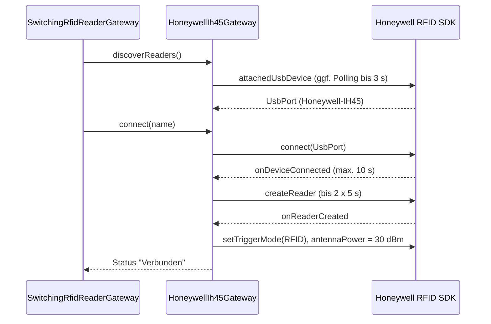

# 07 Schnittstellen, Hardware und GS1

| | |
|---|---|
| **Stand** | 2026-10-01 |
| **Quellen** | `device/*`, `core/gs1/Gs1ParserService.kt`, Design-Spec (Hardware-Spike 2026-09-30), Hardware-Abnahme CT37 + IH45 + RFD8500 (2026-10-01), Tests |

## 1 Hardware und SDKs

| Gerät | Rolle | Anbindung | SDK (lokal im Repository) |
|---|---|---|---|
| **Honeywell CT37** (Android 14) | Host-Gerät der App; 2D-Scanner, Anzeige, Ton, Vibration | integrierter Scanner | `app/libs/DataCollection.aar`, `app/libs/hedc-release.aar` (AIDC-API) |
| **Zebra RFD8500** | RFID-Reader (UHF) mit Trigger | Bluetooth | `vendor/zebra/*.aar` (Zebra RFID API3 2.0.5.238, u. a. `API3_READER`, `API3_TRANSPORT`, `rfidhostlib`, `BarcodeScannerLibrary`); `API3_LLRP*` wird im Build **ausgeschlossen** (siehe Abschnitt 3a.1) |
| **Honeywell IH45** | RFID-Reader (UHF) mit Trigger; zweiter, gleichwertiger Reader | **USB** (`/dev/ttyACM0`, 115200 Baud, USB-IDs `0C2E:10EA`, Name „Honeywell-IH45“); Bluetooth **nicht umgesetzt** | `vendor/honeywell/honeywell_rfid_sdk_v01.01.03.04.11.aar` (Honeywell RFID SDK, von Honeywell signiert, im Git eingecheckt) |

Beispiel-Apps der Hersteller (`vendor/zebra/HHSampleApp`, `ZIOTCSampleApp`) sind nicht Teil des Builds und per `.gitignore` ausgeschlossen.

Die App spricht zur Laufzeit mit **genau einem** RFID-Reader: Ist der IH45 per USB gesteckt, hat er Vorrang, sonst wird der RFD8500 per Bluetooth verwendet (`SwitchingRfidReaderGateway`, Abschnitt 2.3).

## 2 Gateway-Schnittstellen

### 2.1 `BarcodeScannerGateway` (Honeywell)

| Methode | Beschreibung |
|---|---|
| `observeScans(): Flow<String>` | decodierte Rohdaten (nicht-leer) |
| `suspend triggerScan()` | Software-Auslösung: `aim(true)`, `light(true)`, `decode(true)`; wirft `IllegalStateException`, wenn der Scanner nicht verfügbar ist |
| `suspend stopScan()` | `aim/light/decode(false)` (Fehler werden verschluckt) |

Implementierung `HoneywellCt37ScannerGateway`: Initialisierung über `AidcManager.create`, Reader im **CLIENT_CONTROL**-Modus (Hardware-Taste → `onTriggerEvent` → aim/light/decode, Software-Auslösung über `triggerScan`); `claim()` sofort nach dem Anlegen und in `MainActivity.onResume`, `release()` in `onPause`, `close()` in `onDestroy`. Nach einem Treffer (`onBarcodeEvent`) wird der Scanner gestoppt und der Wert per `tryEmit` ausgegeben.

### 2.2 `RfidReaderGateway` (Zebra und IH45)

| Methode | Beschreibung |
|---|---|
| `observeStatus(): Flow<ReaderStatus>` | Verbindungsstatus und Text |
| `observeTagScans(): Flow<String>` | **ein** EPC je Inventory-Session (QCC) |
| `observeTriggerEvents(): Flow<Unit>` | Trigger gedrückt – **nur im Modus `QCC`** |
| `discoverReaders()`, `connect(id)`, `disconnect()` | Verbindungsaufbau (Bluetooth) |
| `triggerInventory()` | Software-Auslösung des Einzel-Tag-Inventory (QCC) |
| `setPower(level)` | Pegel 1–30 → Leistungsindex |
| `setTriggerMode(mode)` | `QCC`, `CAPTURE`, `LOCATE` (Standardimplementierung: nichts) |
| `claimTriggerMode(owner, mode)` / `releaseTriggerMode(owner)` | Besitzer-API (siehe Seite 05, Abschnitt 5.3) |
| `observeHandheldTrigger(): Flow<Boolean>` | `true` gedrückt, `false` losgelassen – nur außerhalb `QCC` |
| `observeProximity(): Flow<Int>` | relative Nähe 0–100 während der Ortung |
| `startLocate(epc, mask)` / `stopLocate()` | Ortung per `TagLocationing` |
| `readEpcsNearby()` | verschiedene EPCs aller im Nahbereich gelesenen Tags (Anlesen) |
| `readTidsNearby(epc, mask)` | TIDs (96 Bit) der Tags mit passendem EPC im Nahbereich |

Die Standardimplementierungen im Interface (leere Flows, `Result.failure(UnsupportedOperation…)`) halten Test-Fakes kompilierbar.

Implementierungen: `ZebraRfd8500Gateway` (Abschnitt 3), `HoneywellIh45Gateway` (Abschnitt 3a) und `SwitchingRfidReaderGateway` (2.3). Hilt bindet die Schnittstelle an das Switching-Gateway. Beim IH45 ist `setPower(level)` ein No-op (immer volle Leistung, ADR-20).

### 2.3 `SwitchingRfidReaderGateway`

Fassade vor Zebra- und IH45-Gateway (`device/zebra/SwitchingRfidReaderGateway.kt`):

| Aspekt | Verhalten |
|---|---|
| Auswahl | genau **ein** Reader gleichzeitig verbunden; IH45 hat Vorrang, wenn er per USB steckt, sonst Zebra (Bluetooth) |
| `discoverReaders()` | liefert die IH45-Namen **zuerst**, dann die Zebra-Reader; `connect(id)` wählt den passenden Reader |
| Wechsel | der andere Reader wird zuerst getrennt (Mutex), dann der gewählte verbunden |
| Flows | `observeStatus/TagScans/TriggerEvents/HandheldTrigger/Proximity` folgen dem aktiven Reader (`flatMapLatest`); die ViewModels merken den Wechsel nicht |
| USB an-/abstecken | `usbPresent` des IH45-Gateways löst automatisch Neuwahl und Verbinden aus |
| Leistung | der zuletzt gesetzte Level wird nach einem Wechsel erneut gesetzt (wirkt nur beim Zebra) |
| Trigger-Modus | `setTriggerMode`, `claimTriggerMode`, `releaseTriggerMode` werden an beide Reader weitergereicht |

Tests: `SwitchingRfidReaderGatewayTest` (7 Tests, Seite 09).

## 3 Zebra-Gateway im Detail

### 3.1 Verbindung und Konfiguration (`configureReader`)

- Beim Start sucht `ScanViewModel` die Reader (`GetAvailableRFIDReaderList`) und verbindet den **ersten**; Verbindungsabbruch (`DISCONNECTION_EVENT`) setzt alle Betriebs-Flags zurück und meldet „Nicht verbunden“.
- Beim Verbinden: Leistungstabelle auslesen (`maxPowerIndex`), Event-Listener registrieren, Handheld- und Tag-Read-Events aktivieren, **Trigger → RFID-Modus**, Start-/Stop-Trigger **sofort**, **Dynamic Power Optimization aus** (nur RFD8500), Antenne 1: Leistungsindex, `rfModeTableIndex 0`, `Tari 0`, **Singulation Session S0, Zustand A, SL-Flag „alle“**, Access-Operation-Timeout 1000 ms.
- Konfigurationsfehler werden als Statustext „Konfigurationsfehler: …“ ausgegeben.

### 3.2 Leistung

- UI-Pegel 1–30 → Index `(pegel − 1) × maxPowerIndex / 29`. Standard-Pegel 1 → **Index 0 (Minimum)**.
- **Nahbereichs-Lesen** (Anlesen, TID): temporär **5 % des Indexbereichs** (`NEARBY_POWER_PERCENT`), mindestens Index **15** (`MIN_NEARBY_POWER_INDEX`, hardware-verifiziert bei 300 Stufen), höchstens `maxPowerIndex`; danach Wiederherstellung der Anwender-Leistung (ein Wiederholungsversuch; bei Fehlschlag Statustext „Power-Fehler: …“).

### 3.3 Operationen und Exklusivität

| Operation | Dauer | Bedingung |
|---|---|---|
| QCC-Inventory | bis zum ersten Tag oder Trigger-Loslassen | `inventoryActive` (AtomicBoolean) |
| Ortung | solange aktiv | `locateActive`; Start nur, wenn weder Nearby noch Inventory läuft |
| Nearby-Lesen | **700 ms** (`NEARBY_READ_WINDOW_MS`) | `nearbyActive`; nicht parallel zu Ortung/Inventory; stoppt in `finally` immer die Operation |

Verletzungen liefern „Reader beschäftigt“. `setTriggerMode(QCC)` stoppt eine aktive Ortung.

### 3.4 Lesen der TID

`TagAccess.readEvent` mit `ReadAccessParams` (Speicherbank **TID**, Offset 0, **count = 6** Wörter = 96 Bit) und **EPC-Filter**: Speicherbank EPC, `bitOffset = 32` (CRC + PC überspringen), Muster = Ziel-EPC, 96 Bit Muster- und Maskenlänge, Maske `FFFFFFFFFFFFFFFFFFFFFFFF`. Ausgewertet werden nur Lese-Operationen mit Status `ACCESS_SUCCESS` und nicht leeren Daten; Ergebnisse werden großgeschrieben und dedupliziert.

### 3.5 Ortung

`TagLocationing.Perform(epc, mask, null)`; die Nähe (`LocationInfo.relativeDistance`) wird als Ganzzahl 0–100 ausgegeben; Stopp setzt die Nähe auf 0.

## 3a Honeywell-IH45-Gateway im Detail

### 3a.1 Einbindung und SDK-Aufrufe (`HoneywellIh45Gateway`, `device/honeywell/`)

| Aspekt | Umsetzung |
|---|---|
| Start | `RfidManager.create(...)` beim Anlegen des Singletons (früh, damit USB-Attach-Ereignisse nicht verloren gehen); danach `addEventListener` |
| Reader-Suche | `attachedUsbDevice` (liefert `UsbPort`); ein beim App-Start schon steckendes Kabel meldet das SDK erst nach Sekunden → die Reader-Suche wartet bis zu **3 s**, ein Hintergrund-Check bis zu **10 s** |
| Verbinden | `connect(UsbPort)` → auf `onDeviceConnected` warten (max. **10 s**) → `createReader` (bis zu **2 Versuche à 5 s**) → SDK-Triggermodus `RFID` → volle Leistung setzen. Timeouts mit `withTimeoutOrNull` (ein `withTimeout` würde als Abbruch verschluckt) |
| Events | `onUsbDeviceAttached/Detached`, `onDeviceConnected/Disconnected`, `onReaderCreated`, `onRfidTriggered(pressed)`, `onTagRead(TagReadData[])` |
| Trigger | `onRfidTriggered(pressed)` nur im SDK-Triggermodus **RFID**; im Modus BARCODE kommen keine Trigger-Ereignisse und der CT37-Scanner reagiert nicht → der IH45 bleibt im Modus RFID; der QR-Scan wird wie beim Zebra per Software ausgelöst |
| Tag-Meldungen | das SDK meldet jedes Tag viele Male pro Sekunde (teils doppelt) |
| Leistung setzen | `antennaPower = [AntennaPower(1, raw, raw)]`; nur setzbar, solange **nicht gelesen** wird → vorher `stopRead` (+ 300 ms) |
| Native Bibliotheken | `libModuleAPIJni.so`, `libSerialPort.so`, `libHonUpgrade.so` (u. a. arm64-v8a); minSdk des SDK 26 (App 28) |
| Logging | Log-Tag `QccIh45` |
| Build | `../vendor/honeywell/*.aar` per `fileTree`; **`API3_LLRP*` aus den Zebra-AARs ausgeschlossen** (Klasse `a.a` kollidiert mit dem Honeywell-SDK, „Duplicate class a.a“; LLRP ist nur für Netzwerk-Reader nötig) |

### 3a.2 Verbindungsablauf

Gemessen: Verbinden nach Einstecken ca. 5 s, Kaltstart ca. 2 s (Hardware-Abnahme 2026-10-01).

### 3a.3 Leistung und Auswahl nach RSSI

Der IH45 läuft **immer mit voller Leistung (30 dBm)**; eine niedrige Sendeleistung zur Reichweitenbegrenzung ist beim IH45 unbrauchbar (5 dBm = Rohwert 500 liest nur bei Berührung, 0 und 100 lesen nichts; die Einheit des SDK ist vermutlich 1/100 dBm, verifiziert für 500…3000). Stattdessen wählt die App das Tag mit dem **stärksten RSSI** (das Tag am Reader); der RSSI ändert sich **nicht** mit der Sendeleistung (Entscheidung: ADR-20).

| Operation | Regel (Konstante) |
|---|---|
| QCC | ab dem ersten Tag mit RSSI ≥ −50 dBm (`QCC_MIN_RSSI`) sammelt der Reader 400 ms (`QCC_WINDOW_MS`) und liefert das **stärkste** Tag; Loslassen des Triggers beendet früher. Feldwerte: gehaltenes Tag −23…−43 dBm, entfernte Tags −56…−60 dBm (ohne Schwelle wurde einmal ein falsches Tag übernommen) |
| Tag übernehmen (Duplikatsuche Phase 1), Fund bestätigen | Nahlesung im Fenster 700 ms (`NEARBY_READ_WINDOW_MS`): es zählen Tags mit RSSI ≥ −50 dBm (`NEARBY_MIN_RSSI`) und höchstens 5 dB (`NEARBY_MARGIN_DB`) unter dem stärksten; mehrere übrig → Meldung „mehrere Tags“. Tag am Reader liest −23…−31 dBm, ein Nachbartag in der anderen Hand ist meist ≥ 5 dB schwächer |
| Fund bestätigen (TID) | die Lesungen der Ortung enthalten die TID; Zwischenspeicher der Treffer 3 s gültig (`LOCATE_CACHE_MS`), nur wenn die Ortung auf Stufe 0 endete, sonst wird die TID frisch gelesen |

### 3a.4 Ortung (Locate) mit Leistungsstufen

Der IH45 hat keinen eigenen Locate-Befehl, den die App nutzt: die Ortung wertet den **RSSI des gesuchten EPC** aus (Maske: `(tag & mask) == (epc & mask)`). Im Nahbereich (0–20 cm) **sättigt** der RSSI (−23…−27 dBm), Berührung und 15–20 cm sind nicht unterscheidbar → die Sendeleistung wird stufenweise gesenkt:

| Stufe | Leistung | Anzeige | Gelesen wird |
|---|---|---|---|
| 0 | voll (30 dBm) | 0–80 % aus der RSSI-Skala (−46 dBm = 0 % bis −27 dBm), ×0,8 | EPC **und TID** |
| 1 | 10 dBm (Rohwert 1000) | 90 % | nur EPC |
| 2 | 5 dBm (Rohwert 500) | 100 % = Berührung | nur EPC |

| Übergang | Bedingung (Konstante) |
|---|---|
| 0 → 1 | Lesung mit RSSI ≥ −29 dBm (`STEP_DOWN_RSSI`), Streak 300 ms (`DWELL_MS`); einzelne schwache Lesungen unterbrechen nicht, Lücke bis 500 ms erlaubt (`STRONG_GAP_MS`) |
| 1 → 2 | auf Stufe 1 300 ms stetig gelesen |
| zurück | 2 s ohne Lesung (`LOSS_MS`) |
| Wiederholsperre | 4 s nach erfolglosem Absenken |
| Ende der Ortung | volle Leistung wird wiederhergestellt |
| Stufe 0 ohne Treffer | nach 1,5 s (`LOCATE_SILENCE_MS`) Anzeige 0 |

Weitere Eigenschaften: TID-Lesen braucht mehr Leistung als eine Inventur, daher liest nur Stufe 0 die TID; jeder Leistungswechsel unterbricht das Lesen ca. 0,5–0,8 s; die Anzeige wird auf den schwachen Stufen alle 250 ms aufgefrischt (nur wenige Lesungen pro Sekunde). **Bekannte Grenze:** der RSSI im Nahfeld schwankt je nach Tag-Lage um 3–5 dB; ungünstig liegende Tags erreichen evtl. nie die Stufe 2.

### 3a.5 Diagnose-Ansicht (temporär)

Die Ansicht „IH45 diagnostics“ (Drawer, Route `ih45diag`; `feature/diagnostics/Ih45Probe`, `Ih45DiagnosticViewModel`, `Ih45DiagnosticScreen`) ist ein **temporärer Hardware-Test** (nur englische Literale, nicht lokalisiert) und soll nach der Abnahme entfernt werden (Seite 13, TD-17). Der Probe öffnet einen zweiten `RfidManager`-Listener und darf **nicht gleichzeitig** mit dem normalen Betrieb benutzt werden. Log-Tag `QccIh45Probe`. Die Bluetooth-Suche der Diagnose ist der Grund für `ACCESS_FINE_LOCATION` (`maxSdkVersion 30`, Seite 11).

## 4 Hardware-Befunde (Spike 2026-09-30, RFD8500)

| # | Befund | Konsequenz |
|---|---|---|
| H1 | `TagLocationing` akzeptiert nur Masken, die **ab dem MSB lückenlos 1** sind. Maske mit Lücke (z. B. `FF1F…`, `FF00…`) → `Invalid EPC Mask`. | Ortung/TID-Prüfung immer **exakt** (`LocateTarget.FULL_MASK`); getippte SGTIN braucht expliziten **Filterwert** (Standard 1, wählbar 0–7). |
| H2 | Exakte Ortung funktioniert; 4–5 Nähewerte/s; Werte 38–99 je nach Abstand. | Tacho/Beep-Takt sinnvoll. |
| H3 | TID-Lesen funktioniert; `count = 0` liefert 96 Bit + 12 angehängte Nullen. | `count = 6` (96 Bit). |
| H4 | Anlesen mit Leistungsindex 0 unzuverlässig; **5 %** (Index 15 von 300) liest zuverlässig bei Kontakt, bei ca. 30 cm nichts. | Nahbereichs-Leistung 5 % mit Untergrenze Index 15. |
| H5 | Trigger-Ereignisse kommen außerhalb des QCC-Modus zuverlässig an; QCC danach unverändert. | Modus-Routing im Gateway. |
| H6 | **Nicht getestet:** zwei Duplikate gleichzeitig an der Pistole (nur ein Duplikat verfügbar). | offener Hardware-Test (Seite 09/13) |
| H7 | Echter Duplikat-EPC `3034F8242800C10300000011` (Filter 1, Partition 5) = SGTIN `4065546.000772.12884901905`. | Testdaten |

### 4.1 Hardware-Befunde IH45 (2026-10-01, CT37 + IH45 + RFD8500)

| # | Befund | Konsequenz |
|---|---|---|
| H8 | Der IH45 funkt per BLE (Beispiel-MAC `0C:23:69:19:BF:BF`), lehnt aber die Kopplung über die Android-Einstellungen ab („Pairing rejected by IH45“). | Anbindung per USB; Bluetooth-Backup offen (Seite 13) |
| H9 | Auf dem CT37 ist die Honeywell-System-App `com.honeywell.datacollection.rfid` vorinstalliert (Activities `SettingsActivity`/`ReadingActivity`, Dienst `RFIDCollectionService`) – vermutlich der vorgesehene Kopplungsweg **[zu bestätigen]**. Sie öffnet den Reader parallel zu unserer App (Log-Tag `IH40Trait`), ohne die Verbindung zu stören. | kein Konflikt beobachtet |
| H10 | Rohwerte der Sendeleistung: 5 dBm = 500 liest nur bei Berührung, 0 und 100 lesen nichts; Einheit vermutlich 1/100 dBm (500…3000 verifiziert); setzbar nur ohne laufendes Lesen. | immer volle Leistung (ADR-20) |
| H11 | RSSI hängt nicht von der Sendeleistung ab; gehaltenes Tag −23…−43 dBm, entfernte Tags −56…−60 dBm; im Nahbereich sättigt der RSSI (−23…−27 dBm). | Auswahl nach RSSI und Leistungsstufen in der Ortung (Abschnitt 3a) |
| H12 | SDK-Triggermodus BARCODE: keine Trigger-Ereignisse, CT37-Scanner reagiert nicht. | Modus RFID |
| H13 | Die USB-Verbindung reißt gelegentlich ab (`USB detached` ohne Zutun, mehrfach beobachtet). Ursache unbekannt (Kabel, Akku, Energiesparen) **[zu bestätigen]**. | offenes Risiko R-15 (Seite 13); Auto-Connect verbindet nach erneutem Anstecken |
| H14 | Stand des Geräts: Akku 100, Region EU, Reader-Firmware V1.2.0.7, Session 1, Profil 3, Standard-Leseleistung 5 dBm (Rohwert 500). | Information |

## 5 GS1-Standards und Parser

### 5.1 Begriffe in Kürze
- **GTIN-14**: Indikator (1) + Company Prefix + Item Reference + Prüfziffer.
- **SGTIN**: GTIN + Seriennummer; **Pure Identity** in der App als `GCP.ItemRef.Serial`, wobei `ItemRef` den Indikator als erste Ziffer enthält.
- **SGTIN-96**: 96-Bit-EPC-Format (24 Hex-Zeichen) für RFID-Tags.

### 5.2 SGTIN-96-Bitaufbau

| Feld | Bits | Hinweis |
|---|---|---|
| Header | 8 | `00110000` = `0x30` |
| Filter | 3 | 0–7; Standard der App für getippte SGTINs: **1** (Verkaufsartikel) |
| Partition | 3 | 0–6, bestimmt die Aufteilung unten |
| Company Prefix + Item Reference | 44 | partitionsabhängig |
| Seriennummer | 38 | max. 2³⁸ − 1; im Parser ohne führende Nullen |

| Partition | GCP-Bits | GCP-Stellen | ItemRef-Bits | ItemRef-Stellen (inkl. Indikator) |
|---|---|---|---|---|
| 0 | 40 | 12 | 4 | 1 |
| 1 | 37 | 11 | 7 | 2 |
| 2 | 34 | 10 | 10 | 3 |
| 3 | 30 | 9 | 14 | 4 |
| 4 | 27 | 8 | 17 | 5 |
| 5 | 24 | 7 | 20 | 6 |
| 6 | 20 | 6 | 24 | 7 |

### 5.3 Parser-Regeln (`Gs1ParserService`)

| Funktion | Eingabe → Ausgabe | Regeln / Fehler |
|---|---|---|
| `parseQr(raw)` | String → `QrScanResult` | Regex `.*/01/(\d{14})/21/([^/]+).*`; sonst „QR-Code enthält keine erwartete GTIN/Seriennummer-Struktur“ |
| `buildQrSgtin(gtin, serial)` | → `GCP.ItemRef.Serial` | GTIN 14-stellig; Serial nicht leer; **GCP = 7 Stellen fest** (Stellen 2–8 der GTIN), ItemRef = Indikator + Stellen 9–13; Prüfziffer entfällt. **Nur für Anzeige und Persistenz** (`sgtinQr`); der Vergleich nutzt diesen String nicht mehr |
| `parseEpcToSgtin(epc)` | 24 Hex → `RfidScanResult` | nur Hex; gerade Länge; genau 24 Zeichen; Header `0x30`; Partition 0–6; GTIN ≠ 0…0; Serial ≠ `0000000000`; Prüfziffer wird berechnet (Gewichte 3/1) |
| `parseLocateTarget(input, filter)` | EPC (24 Hex) **oder** `Ziffern.Ziffern.Ziffern` → `LocateTarget` | sonst „Eingabe ist weder EPC (24 Hex) noch SGTIN“; ein Hex-EPC trägt seinen Filter selbst |
| `encodeSgtin96(gcp, itemRef, serial, filter)` | → 24 Hex | GCP 6–12 Stellen; ItemRef-Länge passend zur Partition; Filter 0–7; Serial ohne führende Null (außer `0`) und < 2³⁸ |

### 5.4 Durchgerechnetes Beispiel

| Größe | Wert |
|---|---|
| QR (Rohdaten) | `http://qr.c-a.com/01/04065546927682/21/12884901894` |
| GTIN-14 | `04065546927682` (Indikator `0`, GCP `4065546`, ItemRef ohne Indikator `92768`, Prüfziffer `2`) |
| QR-SGTIN | `4065546.092768.12884901894` |
| EPC (Filter 1, Partition 5) | `3034F824285A980300000006`: Header `30`, Filter `001`, Partition `101`, GCP-Bits für `4065546`, ItemRef-Bits für `092768`, Serial 12884901894 = `0x300000006` |
| EPC (Filter 0) | `3014F824285A980300000006` – **derselbe** SGTIN, daher `MATCH` im QCC-Vergleich (der Filterwert fließt nicht ein) |

> Der QCC-Vergleich vergleicht **GTIN-14 und Seriennummer** (`qr.gtin == rfid.gtin` und gleiche Seriennummer), **nicht** EPC-Bits und nicht den Punkt-String; weder Filterwert noch Länge des Company Prefix beeinflussen ihn. Für die **Ortung/TID-Prüfung** (exakte EPC-Maske) ist der Filterwert dagegen entscheidend.

## 6 Interne Ereignisströme

| Ströme | Typ | Puffer |
|---|---|---|
| `scanFlow` (Honeywell), `tagFlow`, `triggerFlow` (Zebra, entsprechend im IH45-Gateway) | `MutableSharedFlow`, `extraBufferCapacity = 1`, `DROP_OLDEST` | 1 |
| `handheldTriggerFlow` | `MutableSharedFlow<Boolean>` | 4 |
| `proximityFlow` | `MutableSharedFlow<Int>` | 16 |
| `statusFlow` | `MutableStateFlow<ReaderStatus>` | – |

Hardware-Ereignisse werden nie blockierend zugestellt; bei vollem Puffer geht das älteste verloren.

## 7 Schnittstellen nach außen

| Schnittstelle | Richtung | Details |
|---|---|---|
| Dateisystem (`Documents`) | Ausgabe | CSV; `MediaStore` ab API 29 |
| Netzwerk | – | keine; geplante Erweiterung EPCIS 2.0 (Retrofit/OkHttp, `INTERNET`), Seite 13 |
| Intent-Filter | Eingabe | nur `MAIN/LAUNCHER`; Activity `exported=true` |
